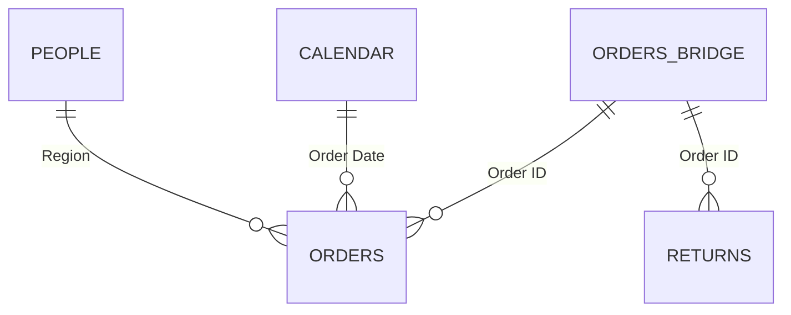

# Superstore Sales & Profitability Analysis


An end-to-end analysis of Superstore transactional data, from data quality checks and Excel exploration through a relational Power BI model to an interactive four-page dashboard. The project examines where the business earns and loses money across time, products, geography, customers and returns, and turns the findings into recommendations.

---

## Table of Contents

1. [Project Overview](#project-overview)
2. [Business Problem](#business-problem)
3. [Business Questions](#business-questions)
4. [Dataset](#dataset)
5. [Tools & Skills Demonstrated](#tools--skills-demonstrated)
6. [Data Quality Check](#data-quality-check)
7. [Data Cleaning & Preparation](#data-cleaning--preparation)
8. [Data Model](#data-model)
9. [Calendar Table & Time Intelligence](#calendar-table--time-intelligence)
10. [DAX Measures](#dax-measures)
11. [Excel Exploratory Analysis](#excel-exploratory-analysis)
12. [Dashboard Walkthrough](#dashboard-walkthrough)
13. [Key Insights](#key-insights)
14. [Recommendations](#recommendations)
15. [How to Use / Repository Structure](#how-to-use--repository-structure)
16. [Author & Contact](#author--contact)

---

## Project Overview

This project analyses the Superstore sales dataset (orders placed between 2018 and 2021) to understand what drives revenue and profit, and where profit is being lost.

The workflow has two stages:

1. **Excel:** data quality checks, cleaning and exploratory analysis with pivot tables and written findings.
2. **Power BI:** a relational data model with a dedicated Calendar table, a library of DAX measures, and an interactive dashboard built for business users.

**Headline results (all years, 2018 to 2021):**

| Metric | Value |
|---|---|
| Total Sales | 2.30M |
| Total Profit | 286.41K |
| Total Orders | 5,009 |
| Profit Margin | 12.47% |
| Return Rate | 5.91% (296 returned orders) |

## Business Problem

Sales volume on its own can be misleading. A product, category or region can sell well and still lose money once costs and discounts are taken into account. Management needs a view that shows revenue, profit, customer value and returns side by side, so decisions are based on profitability and not just on how much is sold.

## Business Questions

1. How are sales performing over time?
2. Which products and categories drive sales and profit?
3. Where is the business most and least profitable (region, state, category)?
4. Which customer segments and individual customers contribute the most?
5. What is the return rate, and where are returns concentrated?
6. What actions could management take based on these findings?

## Dataset

The source workbook contains three tables.

| Table | Role | Description |
|---|---|---|
| **Orders** | Fact table | One row per product line within an order: Order ID, Order Date, Customer, Product, Category, Sub-Category, Region, State, City, Sales, Quantity, Discount, Profit, and more (21 columns). |
| **People** | Lookup | Regional Manager mapped to Region. |
| **Returns** | Lookup | Order IDs that were returned. |

- **Period:** orders placed 2018 to 2021
- **Size:** 9,993 order lines after cleaning, covering 5,009 unique orders
- **Discount** is stored as a decimal between 0 and 1 (for example, 0.20 = 20%)

## Tools & Skills Demonstrated

**Tools:** Microsoft Excel, Power Query, Power BI, DAX

**Skills:**
- Data quality assessment, cleaning and validation
- Dimensional data modelling (fact table, lookup tables, bridge table, dedicated date table)
- DAX: KPIs, ratios, time intelligence, and context manipulation with `TREATAS`
- Interactive dashboard design with a consistent theme and navigation

**Power BI features used:** field parameters, drillthrough, Top N filters, tooltip pages, conditional formatting, navigation buttons, drillable charts, and Smart Narrative.

## Data Quality Check

Before any cleaning, the Orders data was inspected to separate values that look unusual from values that are actually wrong. Only the second kind should be corrected.

| Check | What was examined | Finding | Decision |
|---|---|---|---|
| Exact duplicate rows | Rows identical across every column | 1 duplicate found (9,994 rows down to 9,993) | **Removed** |
| Repeated Order IDs | Order IDs appearing on more than one row | 9,993 rows for 5,009 unique orders; each order has one row per product | **Kept.** This is valid, not duplication. |
| Negative profit | Rows where Profit is below zero | Present across transactions | **Kept.** These are genuine loss-making sales and central to the analysis. |
| Discount values | Range and format of the Discount column | Stored as a decimal between 0 and 1 (0.20 = 20%) | **No change.** Interpreted as a percentage. |
| Date ranges | Order Date and Ship Date | Order Date runs 2018 to 2021; Ship Date runs 2018 to 2022 | **No change.** Order Date is used as the primary date for sales analysis. |
| Customer identity | Customer names against Customer IDs | Customer names can repeat | **Customer ID used as the customer key.** |
| Returns | Order IDs in the Returns table | 296 unique returned orders | **Linked to Orders** at order level through a bridge table (see Data Model). |

The guiding rule was to remove only what was provably wrong (the exact duplicate) and to keep everything that is unusual but legitimate.

## Data Cleaning & Preparation

- **One exact duplicate row was removed** from Orders (9,994 to 9,993 rows).
- Negative profit values, repeated Order IDs and the discount values were **left unchanged**, for the reasons given above.
- The cleaned tables are stored in the workbook as **Clean Orders**, **Clean People** and **Clean Returns**.

## Data Model

The model has five tables: **Orders** (fact), **People**, **Calendar**, **Returns** and **Orders Bridge**.



| Relationship | Key | Cardinality |
|---|---|---|
| People to Orders | Region | One-to-many |
| Calendar to Orders | Calendar date to Order Date | One-to-many |
| Orders Bridge to Orders | Order ID | One-to-many |
| Orders Bridge to Returns | Order ID | One-to-many |

**Why an Orders Bridge table?** Order ID repeats in Orders because each order has one row per product line, so Orders cannot sit on the "one" side of a relationship with Returns. Relating them directly would create a many-to-many relationship. The Orders Bridge holds one row per unique Order ID and acts as the single "one" side for both tables, which keeps every relationship clean and one-to-many.

**Consequence for the measures:** filters flow one way, from the bridge down to Orders and Returns. A filter on an Orders column such as Category therefore does not reach Returns, which required a dedicated measure for returned orders (see DAX Measures).

## Calendar Table & Time Intelligence

Time intelligence uses a **separate Calendar table** rather than the Order Date column inside Orders.

**Why a separate table:**
- Time-intelligence functions such as `SAMEPERIODLASTYEAR` and `DATEADD` need a continuous column of dates. Order Date only contains days on which an order was placed, so it has gaps.
- A dedicated Calendar covers every day across the order period (2018 to 2021), so period comparisons shift correctly.
- It provides one shared place for date attributes, so every page filters time the same way.

**How it is connected:** the Calendar table has a one-to-many relationship to Orders on Order Date, as shown in the Data Model section.

**What it includes:** date attributes such as Date, Day Of Week, Month, Month name, Month Short, and Start of week, month, quarter and year.

The previous-period measures (previous month and previous year) and the MoM and YoY percentages run over the Calendar table's date column and not over Order Date.

## DAX Measures

All measures are stored as explicit measures and reused across pages.

**Core measures**

| Measure | Definition |
|---|---|
| Total Sales | Sum of Sales |
| Total Profit | Sum of Profit |
| Total Orders | Count of unique orders |
| Total Customers | Count of unique customers |
| Average Order Value | Total Sales divided by Total Orders |
| Average Sales Per Customer | Total Sales divided by Total Customers |
| Profit Margin | Total Profit divided by Total Sales |
| Returned Orders | Count of unique returned orders, responsive to category and other filters |
| Return Rate % | Returned Orders divided by Total Orders |
| Previous Month / Previous Year | Sales, Profit, Orders and Customers shifted back one month or one year |
| MoM % / YoY % | Percentage change against the previous month or year, for each of the four metrics |

**Profit margin**

```dax
Profit Margin = DIVIDE([Total Profit], [Total Sales])
```

**Returns**

```dax
Returned Orders =
CALCULATE(
    DISTINCTCOUNT(Orders[Order ID]),
    TREATAS(VALUES(Returns[Order ID]), Orders[Order ID])
)

Return Rate % = DIVIDE([Returned Orders], [Total Orders])
```

An earlier version of Returned Orders counted from the Returns table and showed the same total (296) on every category row, because a category filter on Orders cannot travel up through the bridge to Returns. `TREATAS` takes the list of returned Order IDs and applies it as a filter on `Orders[Order ID]`, so the category filter and the returns filter meet on the same table. After the change, return rates differ by category and the grand total is unchanged. An order that contains products from more than one category counts toward each of them, so the category counts add up to more than the unique total.

**Time intelligence (example for Sales)**

```dax
Previous Year Sales =
CALCULATE([Total Sales], SAMEPERIODLASTYEAR('Calendar'[Date]))

Sales YoY % =
DIVIDE([Total Sales] - [Previous Year Sales], [Previous Year Sales])

Previous Month Sales =
CALCULATE([Total Sales], DATEADD('Calendar'[Date], -1, MONTH))

Sales MoM % =
DIVIDE([Total Sales] - [Previous Month Sales], [Previous Month Sales])
```

> **Note:** year-over-year measures are meaningful when a single year is selected. With no year selected, the previous-year measure shifts the whole 2018 to 2021 range back by one year, so the comparison is between periods of different length.

## Excel Exploratory Analysis

The workbook includes an **Analysis** sheet with headline KPIs and pivot tables by category, region, state, sub-category and customer segment, each with written findings. Highlights:

- **States:** Texas has the largest loss (-25.7K, a -15.12% margin). Ohio's margin is -21.75%, driven by Technology losses. Pennsylvania's is -13.35%, driven by Furniture. Losses are concentrated in specific state and category combinations, and several of the problem states also carry high discounts.
- **Sub-categories:** Tables are the biggest concern (-17.7K profit, -8.56% margin), and Bookcases and Supplies are also loss-making. Copiers earn a 37.20% margin, and Paper, Labels, Envelopes and Fasteners all exceed 30%.
- **Segments:** Consumer has the highest sales and profit but the lowest margin (11.55%). Home Office has the lowest sales but the highest margin (14.05%).

## Dashboard Walkthrough

The report has a dark theme, a consistent card style, left-hand navigation buttons, and a filter button that opens the year and category slicers.

### 1. Executive Overview

- KPI cards for Total Sales, Total Profit, Total Orders, Return Rate and Profit Margin.
- Area chart of sales or profit, switched by a field-parameter slicer, with drill up and down through year, quarter, month and day.
- Profit margin % by category, with a tooltip page showing that category's sales, profit, orders, margin, return rate and monthly sales and profit trend.
- Sales by region.
- Top 10 products matrix (Top N filter by profit) with data bars and conditional formatting. Right-clicking a product drills through to the Product Detail page.
- Cards for the most ordered and most sold sub-categories.

### 2. Geographic Map

- Bubble map of the United States with year buttons (Select all, 2018 to 2021) and dropdown slicers for Region, Category and State.
- A **Geographic Metric** field parameter switches the bubbles between Total Sales, Profit and Profit Margin %.

### 3. Product Detail (drillthrough)

- Reached by drilling through from the Top 10 matrix on the Executive page.
- Cards for product name, sales, profit, orders and profit margin.
- Area chart with a **Product Selection Metrics** field parameter (Total Sales, Total Profit, Total Orders, Profit Margin) and a 2018 to 2021 year range slider.
- A Smart Narrative that summarises the selected product automatically.

### 4. Customer Analysis

- KPI cards for Unique Customers (with MoM and YoY) and Average Sales per Customer.
- Line chart with a field-parameter toggle between customer count and average sales per customer.
- Donut charts of sales and profit margin % by segment.
- Top 100 Customers table using a Top N filter on Customer ID, covering all years.
- Cards showing the top customer's name, orders and profit.

## Key Insights

1. **Seasonality:** across 2018 to 2021, monthly sales peak in November and are lowest in February, with a secondary spike in September.
2. **Furniture is the weak category.** Its profit margin is 2.49%, against 17.40% for Technology and 17.04% for Office Supplies. The overall margin is 12.47%.
3. **Loss-making sub-categories:** Tables, Bookcases and Supplies lose money, while Copiers, Paper, Labels, Envelopes and Fasteners earn margins above 30%.
4. **Losses are local.** Texas, Ohio and Pennsylvania are the main loss-making states, and the losses sit in specific state and category combinations (Technology in Ohio, Furniture in Pennsylvania) and not across a whole state.
5. **Consumer is the largest segment but earns the lowest margin.** It has the highest sales and profit with a margin of 11.55%, while Home Office has the highest margin (14.05%).
6. **Returns are moderate and fairly even across categories.** The overall return rate is 5.91%. Technology (7.97%), Furniture (7.71%) and Office Supplies (6.25%) are close together, and the West has the highest return rate of any region.

These findings describe patterns in the data. They do not establish what causes them.

## Recommendations

1. **Review Furniture economics.** Examine pricing, discounting and costs on Tables and Bookcases before investing in more Furniture volume.
2. **Investigate the problem states.** Look at the state and category combinations behind the losses in Texas, Ohio and Pennsylvania, and test whether discount guardrails improve margin there.
3. **Look into returns in the West.** Find out what is driving the higher return rate in that region and track it over time.
4. **Protect margin in the Consumer segment**, and consider growing Home Office accounts, which earn a higher margin per sale.
5. **Plan around Q4 seasonality.** Align inventory and staffing with the September and November peaks.
6. **Retain top customers.** Use the Top 100 Customers view to prioritise retention of the highest-value accounts.

## How to Use / Repository Structure

```
.
├── README.md
├── Sample - Superstore project.xls    # Cleaned data, Analysis sheet, pivots and insights
├── Sample - Superstore.pbix           # Power BI report (model, measures, dashboard)
└── screenshots/                       # Dashboard screenshots
```

**To explore the dashboard**

1. Open `Sample - Superstore.pbix` in Power BI Desktop.
2. Use the left-hand navigation buttons to move between pages.
3. Use the filter button to open the year and category slicers.
4. To reach the Product Detail page, right-click a product in the Top 10 matrix on the Executive page and choose **Drill through**.

